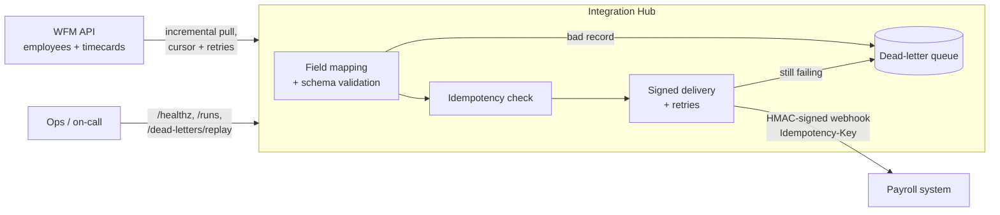

# WFM Integration Hub

[](https://github.com/Vishu-ak/wfm-integration-hub/actions/workflows/ci.yml)

An integration service that keeps **payroll in sync with a workforce management (WFM) system**.
It pulls approved timecards from a UKG-style WFM API, maps them to the payroll schema, and
delivers them to payroll over signed webhooks, the kind of flow an iPaaS like Dell Boomi
usually runs between UKG Pro WFM and an HR/payroll platform.

The goal is the boring-but-critical guarantee every payroll integration needs:
**every approved hour is paid exactly once, and nothing is silently dropped.**



## What it handles

| Problem in real integrations | How the hub handles it |
|---|---|
| WFM or payroll API is briefly down | Retries with exponential backoff and jitter on network errors, timeouts, 429 and 5xx; honours `Retry-After`; never retries a 4xx |
| The same timecard is read twice, or a delivery is retried | Idempotency key per timecard **version**, stored locally and sent as `Idempotency-Key`, so payroll books it once |
| A timecard is edited after it was sent | A new version gets a new key and is delivered again, with `sourceVersion` so payroll can supersede the old one |
| A record can't be mapped (unknown pay code, impossible hours, missing employee) | Goes to a dead-letter queue with a readable reason; the rest of the run continues |
| A crash halfway through a large sync | The cursor is checkpointed after every page, so the next run resumes where it stopped |
| Someone forges or replays a webhook | Payloads are HMAC-SHA256 signed over `timestamp.body`, verified in constant time, rejected if older than 5 minutes |
| The sync quietly stops running | `/healthz` returns **503** if the last run failed or no run has succeeded recently, so Kubernetes and alerting notice |
| Two syncs triggered at once | A single in-flight run is shared instead of racing |
| Mapping rules change | Mappings are declarative config (source path, target field, transform, pay-code table), not code |

## Quick start

Requires Node 20+.

```bash
npm install
npm test                 # 20 tests: mapping, signing, retries, end-to-end sync, admin API
npm run mock             # starts a mock WFM API (:9001) and mock payroll webhook (:9002)
cp .env.example .env     # in another terminal
set -a; source .env; set +a
npm run dev              # starts the hub on :8080 and syncs every 60s
```

The mock WFM API fails every 7th request and payroll rejects its first two deliveries,
so a local run shows the retries working. One sample timecard uses a pay code payroll
doesn't know (`BEREAVEMENT`), so it lands in the dead-letter queue.

```bash
curl -s localhost:8080/healthz
curl -s -X POST localhost:8080/sync -H "authorization: Bearer $ADMIN_TOKEN"
curl -s localhost:8080/dead-letters -H "authorization: Bearer $ADMIN_TOKEN"
```

## API

| Method | Path | Auth | Purpose |
|---|---|---|---|
| GET | `/healthz` | none | 200 when healthy, 503 when the last run failed or syncs have gone stale |
| POST | `/sync` | admin | Run a sync now and return its report |
| GET | `/runs` | admin | The last 50 run reports |
| GET | `/dead-letters` | admin | Records that could not be mapped or delivered, with reasons |
| POST | `/dead-letters/replay` | admin | Re-map and re-deliver them, e.g. after fixing a mapping |

Admin endpoints take `Authorization: Bearer <ADMIN_TOKEN>`, compared in constant time.

## Configuration and secrets

All configuration is read from environment variables and validated at startup
(`src/config.ts`); the service refuses to start with a missing or weak secret.

On **GKE**, `k8s/external-secret.yaml` syncs the credentials from **Google Secret Manager**
into a Kubernetes Secret through the External Secrets Operator, so no credential lives in the
repo, the image, or a manifest.

## Deploying to GKE

```bash
docker build -t us-docker.pkg.dev/PROJECT_ID/apps/wfm-integration-hub:latest .
docker push us-docker.pkg.dev/PROJECT_ID/apps/wfm-integration-hub:latest
kubectl apply -f k8s/external-secret.yaml -f k8s/deployment.yaml
```

The container runs as a non-root user with a read-only root filesystem, all Linux
capabilities dropped and the default seccomp profile. The readiness probe uses `/healthz`.

## Project layout

```
src/
  sources/wfmClient.ts    WFM API client: bearer auth, cursor pagination
  mapping.ts              declarative field mapping + zod schema validation
  sinks/payrollSink.ts    signed webhook delivery with Idempotency-Key
  pipeline.ts             incremental sync, checkpointing, dead letters, replay
  http.ts                 fetch with timeouts, backoff + jitter, Retry-After
  signing.ts              HMAC signing / verification, constant-time compare
  store/stateStore.ts     cursor, processed keys, dead letters (atomic file writes)
  app.ts, server.ts       admin API, health, scheduler, graceful shutdown
  mock/                   mock WFM API and payroll webhook for demos and tests
k8s/                      GKE deployment and Secret Manager wiring
```

## CI

GitHub Actions type-checks, tests and builds on Node 20 and 22, then builds the Docker
image and smoke-tests its health endpoint.

## License

MIT
